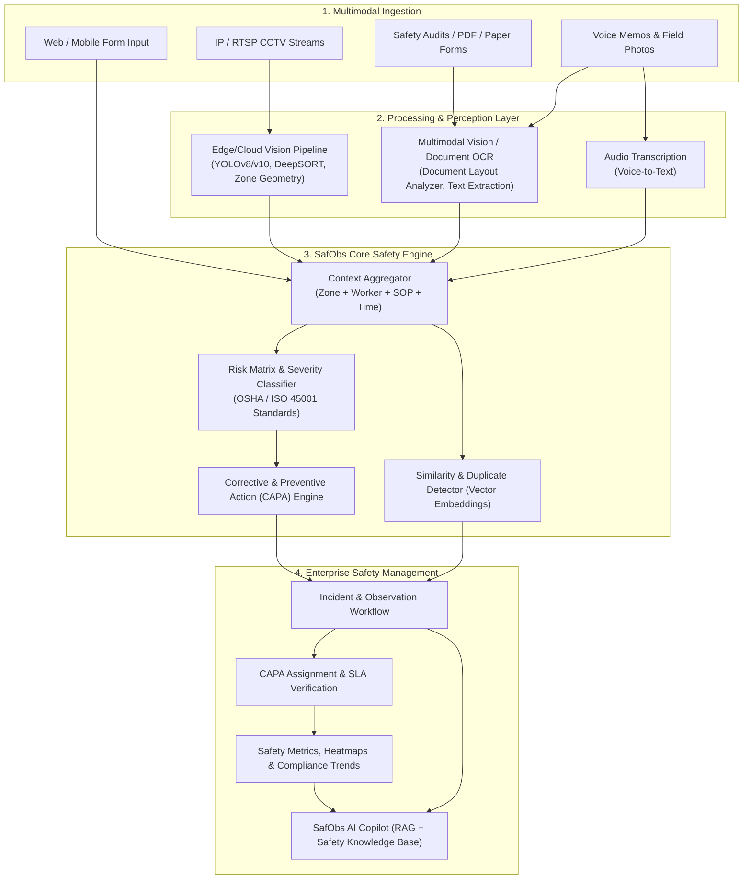
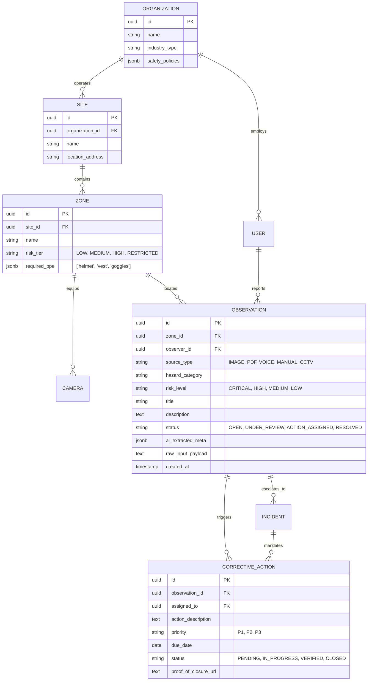

# SafObs: AI-Powered Industrial Workplace Safety Platform
## Master Product & Engineering Blueprint

---

### Executive Vision & Philosophy
Industrial safety operations suffer from high latency between hazard occurrence, manual observation logging, and actionable remediation. Most incidents occur not because safety rules don't exist, but because **compliance checks are sporadic, manual reporting is tedious, and CCTV video feeds are passively stored without real-time intelligence.**

**SafObs** solves this by establishing a phased closed-loop safety operating system:
1. **Zero-Friction Observation Logging** (OCR, multimodal image/doc processing, voice memos).
2. **Context-Aware Safety Intelligence** (automated risk scoring, root-cause tagging, corrective action generation).
3. **Edge & Cloud Computer Vision** (real-time PPE compliance, restricted zone breaches, multi-camera context).
4. **Autonomous Safety Copilot & Predictive Analytics** (SOP compliance, RAG knowledge retrieval, recurring hazard alerts).

---

## 1. Phased Architecture & Progression Model

---

## 2. Phase-by-Phase Roadmap & Milestones

| Phase | Core Objective | Key Deliverables | Go/No-Go Gate Criteria |
| :--- | :--- | :--- | :--- |
| **Phase 0** | Problem & Market Validation | • ICP & User Personas • Discovery Interview Scripts • Privacy & Surveillance Playbook • Initial Pilot Requirement Matrix | 10+ EHS/Plant Manager interviews confirming manual reporting friction & willingness to pilot |
| **Phase 1** | Safety Observation MVP (No CV yet) | • Multimodal Input (Image, Doc, PDF, Voice, Text) • LLM/OCR Auto-Extraction & Severity Scoring • Observation & CAPA Workflow • Executive Safety Dashboard | Safety officers log complete observations in < 60s with > 85% OCR/LLM field accuracy |
| **Phase 2** | AI Safety Intelligence & Copilot | • Deduplication & Similarity Search • Natural Language Query Engine • Company Safety SOP RAG • Automated Weekly/Monthly Safety Reports | Copilot accurately synthesizes risk trends and auto-generates EHS compliance reports |
| **Phase 3** | Real-Time CCTV MVP (Edge/RTSP) | • RTSP Stream Worker Pipeline • Helmet & Safety Vest Detection • Virtual Restricted Zone Polygon Breaches • Live Alert Feeds & Snapshots | Real-time alerts generated in < 1.5s latency with < 5% false positive rate on pilot camera |
| **Phase 4** | Advanced Vision & Context Engine | • Safety shoes, gloves, eye protection • Heavy equipment proximity / fall risks • Spatial-Temporal Context (Zone + Equipment + Duration) • False-positive suppression | Multi-camera tracking and accurate context events (e.g. "No vest inside active forklift zone") |
| **Phase 5** | Enterprise Safety Platform | • Multi-plant, Multi-zone Tenant Hierarchy • Full Incident Investigation & Root-Cause Analysis (5 Whys, Fishbone) • Verification audits, OSHA/ISO compliance reporting | Enterprise pilot handling multi-facility deployments with role-based governance |
| **Phase 6** | Autonomous Copilot & Predictive Insights | • Anomaly detection across shifts • Leading indicator forecasting (risk spikes) • Interactive EHS voice/chat assistant | Proactive hazard mitigation recommendations accepted and implemented by EHS teams |

---

## 3. Data Model Schema (Phase 1 & Phase 2 Foundation)

---

## 4. Phase 0 Deliverable Package: Discovery & Research Framework

### A. Target Customer Segments
1. **Tier 1 (Immediate Beachhead)**: Heavy Manufacturing & Automotive Assembly (Medium-Large plants, strict safety audits, existing IP cameras, high incident penalty costs).
2. **Tier 2 (Expansion)**: Construction Contractors (Fast-moving environments, dynamic zones, mobile-heavy workflows).
3. **Tier 3 (Enterprise)**: Oil & Gas, Chemicals, Mining (High-risk compliance, hazardous area classifications, strict union/regulatory standards).

### B. Safety Officer Interview Protocol (10 Key Questions)
1. *How many safety observations are logged per week per site, and what percentage of observed hazards actually get reported?*
2. *Walk us through the exact paper/digital path from finding a hazard (e.g. oil spill or missing guardrail) to closing it.*
3. *What are your top 3 most repetitive data-entry bottlenecks in your current EHS software or spreadsheets?*
4. *How do you currently track whether corrective actions were actually executed before an incident occurs?*
5. *How many IP/CCTV cameras are installed in your facility, and who monitors them today?*
6. *What are the biggest barriers to automated camera monitoring (worker privacy, network bandwidth, union concerns, false alarms)?*
7. *How much time do you spend preparing weekly/monthly EHS audit reports for management and regulators?*
8. *What specific PPE or hazard violations cause the most fines or near-misses on your plant floor?*
9. *What is your current budget or spend for EHS software tools per year?*
10. *If a tool could auto-fill safety reports from a photo or voice note in 30 seconds and assign actions automatically, what would stop you from using it tomorrow?*

---

## 5. Phase 1 Engineering Architecture & Tech Stack

- **Frontend**: Next.js 14+ (App Router), TailwindCSS, Lucide Icons, Shadcn UI primitives, Recharts for compliance analytics.
- **Backend API**: Python FastAPI (Async, Pydantic v2, OpenAPI standard).
- **AI / Multimodal Pipeline**:
  - Multimodal Vision LLM & OCR engine for invoice/observation auto-tagging.
  - Whisper API for voice memo transcription.
  - Sentence-Transformers / pgvector for duplicate detection and semantic search.
- **Database & Storage**: PostgreSQL 16 with `pgvector` for incident vector embeddings; S3-compatible object storage (MinIO / AWS S3) for evidence photos, audio clips, and documents.
- **Task Queue**: Celery / Redis or FastAPI BackgroundTasks for async OCR and audio processing.
